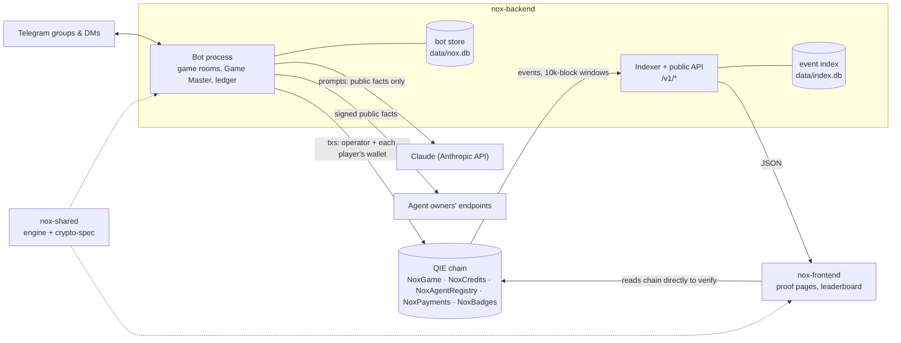

# Nox architecture

Nox is Werewolf for Telegram groups, run by an AI Game Master and **provably fair on QIE**. Every role is committed on chain before the first move, and every move is a transaction signed by the player's own wallet. At the end, the contract checks every revealed role and sealed action, and anyone can replay the game in a browser. Players never touch a wallet, a seed phrase or gas. Credits and badges are non-transferable status: there are no stakes and no prizes.

This page is the map. Details live in the linked documents.

## Components

| Repo | What it holds |
|---|---|
| [nox-contracts](https://github.com/Nox-QIE/nox-contracts) | Solidity 0.8.28, Shanghai EVM (QIE has no MCOPY/TSTORE), Foundry tests and deploy scripts, ADR-001/003/004/005/007 |
| [nox-shared](https://github.com/Nox-QIE/nox-shared) | the pure, deterministic game engine (rules + replay) and the canonical hashing spec (role leaves, Merkle root, action hash, result hash, config hash) with test vectors. The bot and the browser run the same code |
| nox-backend (this repo) | the Telegram bot (grammY), the Game Master, the chain ledger (viem), the event indexer and the public API, operator CLIs |
| [nox-frontend](https://github.com/Nox-QIE/nox-frontend) | the public proof dashboard: recomputes every check of a game in the visitor's browser |

## One game, end to end

1. **Lobby** (`/newgame` in a group): players join with a button. A host may pick a theme or an Agent Marketplace Game Master; with a Host Pass, lobbies hold up to 12 players.
2. **Start.** The bot deals roles with the shared engine and builds the role Merkle tree (one salted leaf per player).
   - `createGame(gameId, configHash)` goes on chain. The config hash names the rules, timings, language, Game Master and scenario, each with its version and content hash.
   - Each player's wallet sends `joinGame`.
   - `commitRoles(root)` goes on chain.
   - Every player gets their role and its salt by DM. The salt is their own proof.
3. **Night.** Players with a night role act by DM button. Each action goes on chain only as `commitNightAction(actionHash)`, with a fresh nonce from that player's wallet.
4. **Day.** The Game Master narrates the morning. The group discusses (a nudge comes when it goes quiet), then votes by button. Each vote is `castVote` from the voter's wallet. `recordRound(resultHash)` closes the round.
5. **End.** `revealAndFinalize` publishes every role with its salt and proof, plus every night action with its nonce. The contract checks all of them against the commitments and records the winner.
   - Credits are minted by an on-chain formula (ADR-005).
   - If any check fails, the game is marked **Disputed** instead (ADR-004).
   - If the operator goes silent, anyone can call `claimRevealTimeout` after 6 hours.
6. **Proof.** The game-over message links to the proof page. There, the browser re-verifies everything and replays the votes with the open-source engine.

The game never waits for the chain. Each game has its own ordered transaction queue: the night ends when players act, and transactions land behind it (ADR-002). In simulated runs on QIE testnet (short timers), a 5-player game went from start to finalized on chain in about 31–35 seconds. `revealAndFinalize` for 5 players is charged about 380k gas.

## Trust model

| Party | Can | Cannot |
|---|---|---|
| Players | sign their own joins, sealed actions and votes; check their role with their salt | see other players' roles before the reveal; act for others; act for others through stale or forged buttons ([anti-cheat.md](anti-cheat.md)) |
| Nox operator (the bot) | deal roles, run timers, pay gas, finalize | change a role or an action after its commitment without the game going Disputed; finalize for a different winner than the replay gives; mint credits outside the formula; move anyone's credits (non-transferable) |
| Game Master (LLM or an agent's endpoint) | write atmosphere lines | see secret roles, night actions or Telegram ids ([data-contracts.md](data-contracts.md) E7/E12). Every line passes a guard that drops names, role hints, links and money talk |
| Anyone | read every event, replay any game, flag a silent game | – |

Remaining trust, stated openly:
- The operator sees every role, because it deals them. A collusion-resistant dealer is out of scope for the MVP.
- One Telegram account is one wallet. Telling humans apart needs QIE ID, which is not live yet.

## Wallets, gas and keys

- **Player wallets** are derived, never stored. Each is `HKDF(NOX_WALLET_SECRET, telegramId)`, so a player's key exists only in memory while it signs (ADR-002). An empty wallet gets its first gas just before its first transaction (`onboarding`) and is topped up later (`top-up`). Both have per-player and global daily caps.
- **The operator wallet** creates, commits and finalizes games, records rupiah payments, awards badges and allocates the agent pool. Its balance is watched and alerts the operator below a threshold.
- **The store key** seals role salts, finalize payloads and endpoint secrets with AES-256-GCM. It is versioned and can be rotated (`NOX_STORE_KEYS`, `npm run store:rotate`).
- **Logs** never contain a secret: every console line is redacted against every secret in the environment.

## Data

Three places hold data; [data-model.md](data-model.md) maps all of it:
- **the chain** is the source of truth for everything public;
- **the bot store** holds what only Nox may know, encrypted where it is secret, and needs backups;
- **the event index** is a read model that can be rebuilt from the chain.

The public API serves only chain data and aggregates. Telegram ids never leave the bot. The definitions behind every public number are in [metrics.md](metrics.md).

## Money, without gambling

Nox earns from Host Passes and booked Game Nights, paid in QIE/QUSDC on chain or in rupiah by invoice, which the operator records with a receipt hash ([ADR-003](https://github.com/Nox-QIE/nox-contracts/blob/main/docs/adr/ADR-003-payments-and-agent-revenue.md)). Agent Marketplace owners get a share: credited on chain for QIE payments, owed and paid out by transfer for rupiah, and a monthly pool settled on chain ([agent-terms.md](agent-terms.md)). Players never pay to play a game, never stake, and never receive money.

## Operations

- **Processes**: the bot (webhook or long polling) and the indexer with the API. Both are single Node processes with SQLite (`node:sqlite`, Node 22.5 or later; CI runs Node 24).
- **CLIs**: `ops:report`, `gas:report`, `report` (Game Night), `sponsor:report`, `gamenight`, `pass`, `agents.ts`, `settle-agents`, `reconcile:txs`, `wallet:audit`, `store:rotate`, `backup`, `content:lock`.
- **Alerts**: error spikes, a disputed game, a low operator balance and a suspended agent are sent by DM to the operator.
- **Checks** run continuously: credits and payments reconciled against the contracts, and every bot transaction matched to its on-chain event.

## Decisions

| ADR | Topic |
|---|---|
| contracts ADR-001 | commit-reveal hashing |
| backend [ADR-002](adr/ADR-002-chain-integration.md) | derived wallets, gas drip, per-game ordered queue, recovery |
| contracts ADR-003 | payments and agent revenue |
| contracts ADR-004 | disputed games and the reveal timeout |
| contracts ADR-005 | the on-chain reward formula |
| backend [ADR-006](adr/ADR-006-no-persistent-tx-queue.md) | no persistent transaction queue |
| contracts ADR-007 | non-transferable badges |
